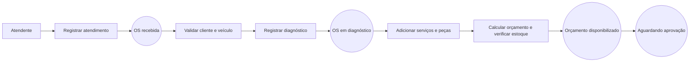
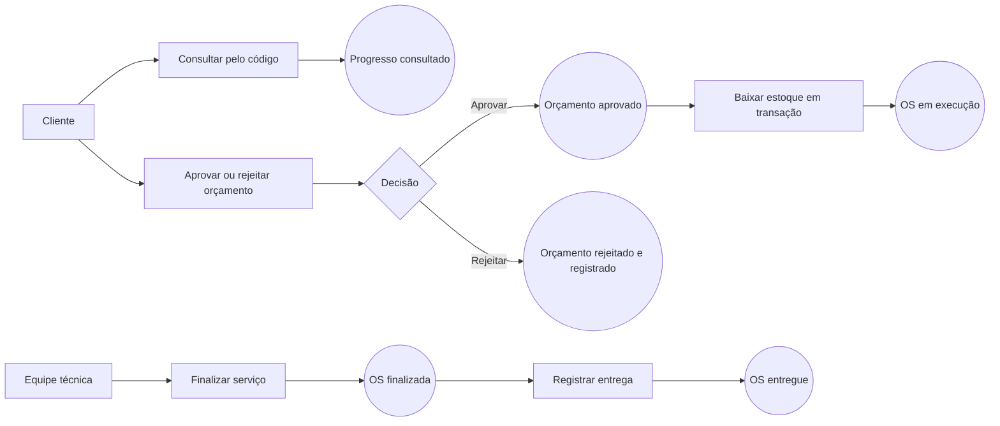
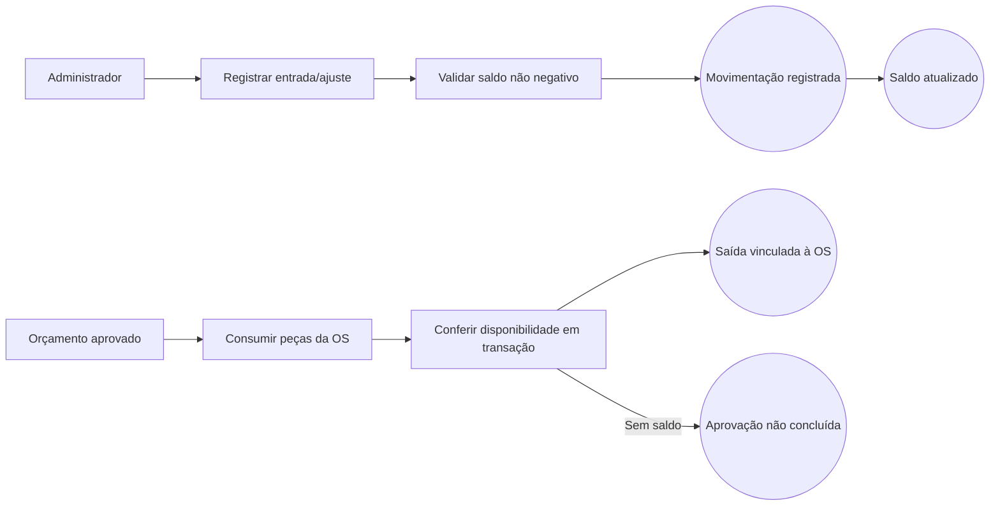
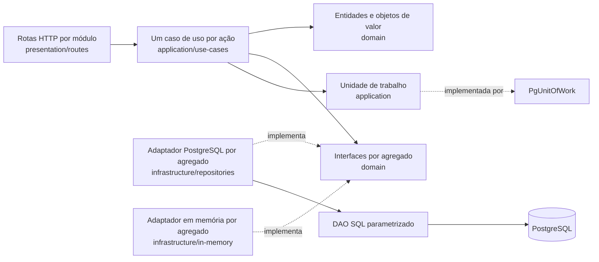

# DDD — Sistema da oficina

Esta modelagem inicial descreve o MVP implementado. O grupo deve validar o Event Storming com todos os integrantes e exportar o quadro colaborativo para PDF ou imagem nesta pasta. O link externo compartilhável deve ser preenchido em `docs/entrega/modelo.md`.

## Linguagem ubíqua

| Termo | Significado neste projeto | Implementação |
|---|---|---|
| Ordem de Serviço (OS) | Registro do atendimento e execução de reparo de um veículo | `work_orders`, rotas `/work-orders` |
| Orçamento | Soma dos serviços e peças cadastrados como itens da OS | `quote_total_cents`, `order_items` |
| Código de acompanhamento | Segredo aleatório entregue ao cliente para consulta pública limitada | `work_orders.tracking_code` |
| Peça/insumo | Item controlado em estoque e usado em uma OS | `parts`, `inventory_movements` |
| Decisão do orçamento | Aprovação ou rejeição registrada pelo cliente | `quote_decisions` |
| Histórico de status | Eventos de transição da OS em ordem cronológica | `status_history` |

## Event Storming: criação da OS

## Event Storming: acompanhamento e decisão

## Event Storming: peças e insumos

## Modelo de domínio

- **Atores:** cliente, atendente/administrador e equipe técnica.
- **Agregado principal:** Ordem de Serviço, com itens, orçamento, decisões e histórico encapsulados pela entidade `WorkOrder`.
- **Agregado de estoque:** Peça, com saldo e movimentações. A saída é atômica no banco para evitar saldo negativo.
- **Entidades implementadas:** Cliente, Veículo, Serviço, Peça, Oficina, Usuário administrativo, Ordem de Serviço, Item de OS, Decisão de orçamento, Mudança de status e Movimentação de estoque.
- **Objetos de valor implementados:** CPF/CNPJ (`TaxDocument`), Placa (`VehiclePlate`), Dinheiro em centavos (`Money`), Quantidade (`Quantity`) e Código de acompanhamento (`TrackingCode`).
- **Bounded contexts:** Atendimento e OS; Catálogo e Estoque; Identidade administrativa. São módulos lógicos dentro do monólito.
- **Políticas:** só veículo do cliente pode entrar na OS; orçamento é calculado pelos preços atuais no momento da criação; estoque é debitado na aprovação; reparos adicionais atualizam o orçamento e exigem nova aprovação, debitando somente itens ainda não consumidos; saldo não pode ficar negativo; transições inválidas são recusadas.

## Relação com o código

| Agregado ou módulo | Entidade raiz | Dados internos | Contrato de persistência | Adaptador |
|---|---|---|---|---|
| Clientes | `Customer` | `TaxDocument` | `CustomerRepository` | `PgCustomerRepository` |
| Veículos | `Vehicle` | `VehiclePlate` | `VehicleRepository` | `PgVehicleRepository` |
| Catálogo de serviços | `Service` | `Money` | `ServiceRepository` | `PgServiceRepository` |
| Estoque | `Part` | `InventoryMovement`, `Money` | `PartRepository` | `PgPartRepository` |
| Oficina | `Workshop` | `TaxDocument` | `WorkshopRepository` | `PgWorkshopRepository` |
| Ordens de serviço | `WorkOrder` | `WorkOrderItem`, `QuoteDecision`, `StatusChange`, `TrackingCode`, `Quantity`, `Money` | `WorkOrderRepository` | `PgWorkOrderRepository` |
| Identidade | `AdminUser` | credencial criptografada | `AdminUserRepository` | `PgAdminUserRepository` |

Os repositórios representam raízes de agregados. Itens, decisões, alterações de status e movimentações são persistidos pelo repositório da raiz que protege suas invariantes. As projeções de consulta e a métrica de tempo médio usam `WorkOrderQueries`, uma porta de leitura da aplicação, separada do contrato de escrita do agregado.

As alterações do estado passam por métodos com intenção explícita: `Customer.rename/changeEmail/changePhone`, `Vehicle.changeBrand/changeModel/changeYear`, `Service.changePrice/changeEstimatedMinutes/activate/deactivate` e `Part.changeMinimumStock/receiveStock/withdrawStock`. Os casos de uso de atualização aplicam somente as ações presentes na requisição antes de salvar a entidade.

- `src/domain/` possui uma pasta por conceito: `customer`, `vehicle`, `service`, `part`, `workshop`, `work-order` e `identity`. Cada agregado possui entidade e contrato do repositório; objetos de valor estão em `shared`.
- `src/application/use-cases/` possui arquivos separados para criar, consultar, listar, atualizar, excluir/desativar e para os fluxos de OS. Casos de uso transacionais recebem `UnitOfWork`; consultas detalhadas recebem a porta `WorkOrderQueries`.
- `src/infrastructure/repositories/` possui um adaptador por repositório. `src/infrastructure/queries/` implementa as projeções de leitura da OS. `src/infrastructure/database/postgres-dao.ts` executa SQL parametrizado e `pg-unit-of-work.ts` compartilha a mesma transação entre adaptadores.
- `src/infrastructure/in-memory/` possui um adaptador por repositório, projeções de leitura e uma unidade de trabalho em memória. Um caso de uso recebe exatamente os mesmos contratos nos dois ambientes; a unidade de trabalho descarta o estado da transação quando ocorre uma exceção.
- `src/presentation/routes/` adapta HTTP, autenticação e schemas. `src/presentation/presenters.ts` traduz entidades para respostas; `src/composition.ts` faz a ligação entre as camadas.

O grupo deve comparar este material com o quadro Miro final e atualizar os diagramas se as decisões do Event Storming mudarem.
