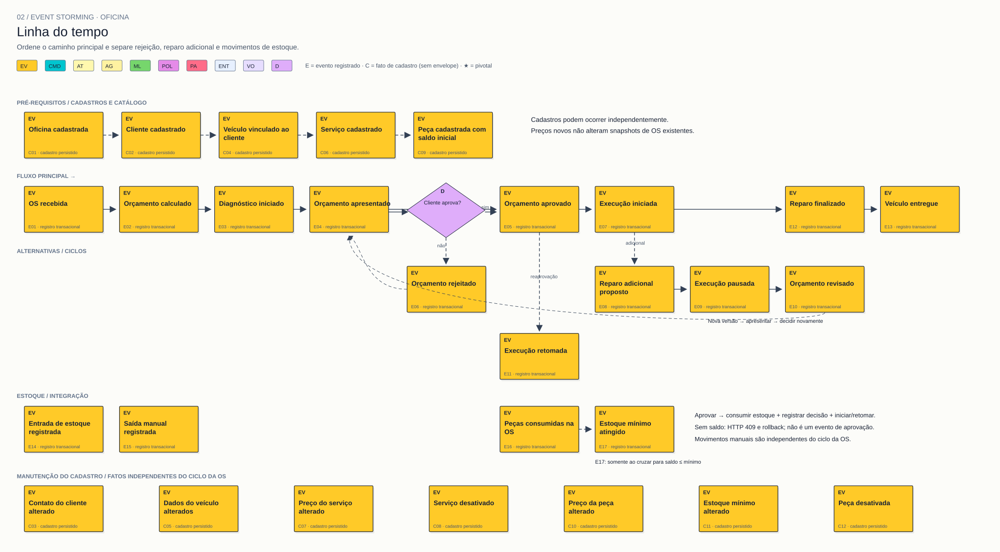

# 02 — Linha do tempo

**Objetivo:** Ordenar acontecimentos, identificar alternativas e ciclos.

[Visualizador](index.html) · [SVG](02-linha-do-tempo.svg) · [Mermaid](02.mmd) · [Índice](../README.md)

O caminho principal é: cadastro de cliente/veículo e catálogo → OS recebida → orçamento calculado → diagnóstico iniciado → orçamento apresentado → orçamento aprovado → execução iniciada → reparo finalizado → veículo entregue.

**Alternativas:** rejeição registra a decisão e mantém espera; reparo adicional pausa execução, revisa/apresenta orçamento e retorna à decisão; nova aprovação retoma execução. O consumo de estoque é parte da transação da aprovação. Entradas e saídas manuais podem acontecer independentemente.

O quadro mostra ordem lógica de negócio, não durações em escala ou ordem de chamadas HTTP. As setas tracejadas indicam caminhos condicionais/retornos. A disponibilidade verificada na criação não representa uma reserva.

**Saída:** sequência principal, rejeição e ciclo adicional, com dependência do estoque explícita.
