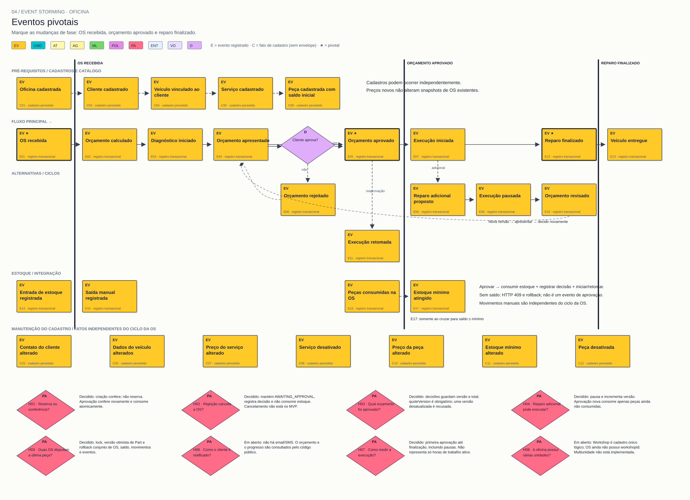

# 04 — Eventos pivotais

**Objetivo:** Marcar fatos que mudam a fase do processo.

[Visualizador](index.html) · [SVG](04-eventos-pivotais.svg) · [Mermaid](04.mmd) · [Índice](../README.md)

- **OS recebida (E01):** atendimento passa a ser uma ordem rastreável.
- **Orçamento aprovado (E05):** trabalho passa de proposta para execução autorizada; estoque é consumido atomicamente.
- **Reparo finalizado (E12):** execução termina; entrega pode ser registrada.

As linhas verticais delimitam essas mudanças no fluxo. Os post-its pivotais recebem ★ e borda espessa. A aprovação revisada repete a mudança de autorização no ciclo de adicional.

**Saída:** fases visíveis que ajudam a discutir responsabilidades; pivotal não cria automaticamente um serviço separado.
