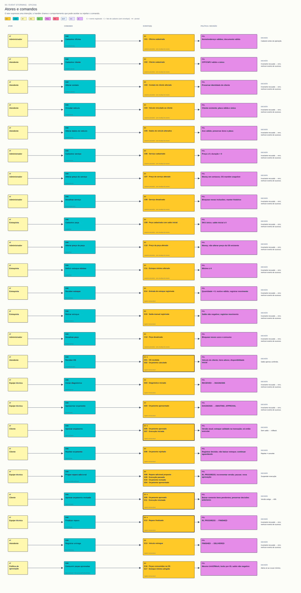

# 05 — Atores e comandos

**Objetivo:** Mostrar quem expressa cada intenção e qual comportamento a atende.

[Visualizador](index.html) · [SVG](05-atores-e-comandos.svg) · [Mermaid](05.mmd) · [Índice](../README.md)

O quadro evolui para linhas de intenção. Cliente aprova/rejeita; atendente recebe OS/entrega; equipe inicia diagnóstico, apresenta orçamento, propõe adicional e finaliza; estoquista recebe/retira estoque; administrador mantém catálogo.

Os atores de negócio compartilham a credencial administrativa atual, exceto o cliente, que usa TrackingCode. Um comando pode falhar por uma invariante. Não chamar isso de evento de sucesso.

**Saída:** comando, ator, handler e eventos aceitos por intenção. Os arquivos dos handlers estão em [rastreabilidade](../rastreabilidade.md).

| Ator | Comando | Handler |
|---|---|---|
| Administrador | Cadastrar oficina | `CreateWorkshop` |
| Atendente | Cadastrar cliente | `CreateCustomer` |
| Atendente | Alterar contato | `UpdateCustomer` |
| Atendente | Vincular veículo | `CreateVehicle` |
| Atendente | Alterar dados do veículo | `UpdateVehicle` |
| Administrador | Cadastrar serviço | `CreateService` |
| Administrador | Alterar preço do serviço | `UpdateService` |
| Administrador | Desativar serviço | `DeactivateService` |
| Estoquista | Cadastrar peça | `CreatePart` |
| Administrador | Alterar preço da peça | `UpdatePart` |
| Estoquista | Definir estoque mínimo | `UpdatePart` |
| Estoquista | Receber estoque | `ReceiveStock` |
| Estoquista | Retirar estoque | `WithdrawStock` |
| Administrador | Desativar peça | `DeactivatePart` |
| Atendente | Receber OS | `CreateWorkOrder` |
| Equipe técnica | Iniciar diagnóstico | `StartDiagnosis` |
| Equipe técnica | Apresentar orçamento | `SubmitQuote` |
| Cliente | Aprovar orçamento | `ApproveQuote` |
| Cliente | Rejeitar orçamento | `RejectQuote` |
| Equipe técnica | Propor reparo adicional | `ProposeAdditionalRepair` |
| Cliente | Aprovar orçamento revisado | `ApproveQuote` |
| Equipe técnica | Finalizar reparo | `FinishRepair` |
| Atendente | Registrar entrega | `RecordDelivery` |
| Política de aprovação | Consumir peças aprovadas | `ApproveQuote / Part.consumeForWorkOrder` |
