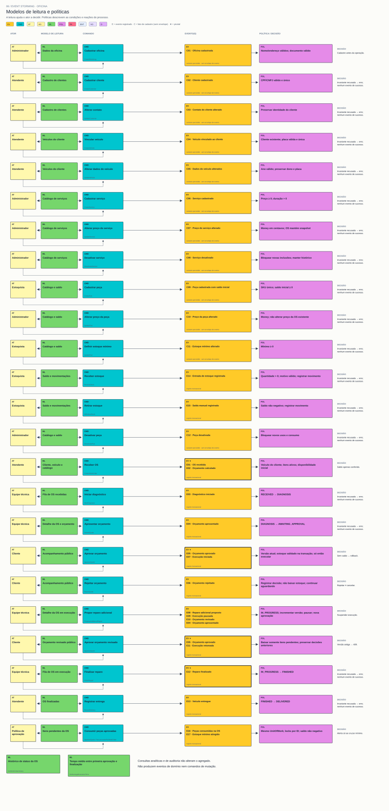

# 06 — Modelos de leitura e políticas

**Objetivo:** Mostrar informação para decidir e condições para aceitar a ação.

[Visualizador](index.html) · [SVG](06-leituras-e-politicas.svg) · [Mermaid](06.mmd) · [Índice](../README.md)

Post-its ML mostram cadastro, catálogo, saldo, movimentos, fila de OS, detalhe administrativo e acompanhamento público. A consulta pública inclui total e quoteVersion. A intenção de aprovar deve levar a versão consultada nas novas integrações.

Políticas: usar veículo do cliente; copiar preço/descrição do catálogo; conferir disponibilidade na criação; consumir só na aprovação; pausar adicional; consumir somente itens pendentes na retomada; nunca permitir saldo negativo; não executar sem aprovação.

Políticas do quadro são implementadas como regras síncronas dos agregados/handlers. Não existe daemon de notificações, consumidor de eventos ou atualização assíncrona de read models. O tempo médio é uma leitura analítica; não origina comando de mutação.

**Saída:** leitura → decisão → comando e regras que justificam cada ramificação.
