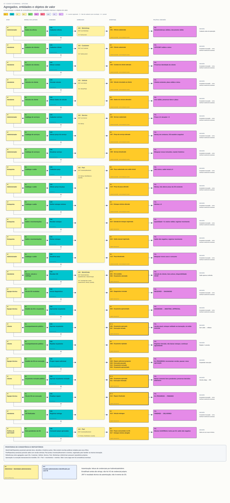

# 07 — Agregados, entidades e objetos de valor

**Objetivo:** Identificar a unidade de consistência que protege cada mudança.

[Visualizador](index.html) · [SVG](07-agregados.svg) · [Mermaid](07.mmd) · [Índice](../README.md)

Uma entidade tem identidade. Um VO tem conteúdo validado, imutável e comparável. O agregado é um conjunto controlado por uma raiz; pode conter apenas a raiz. A raiz WorkOrder controla WorkOrderItem, QuoteDecision e StatusChange; referências a Customer/Vehicle/Service/Part são por ID.

O quadro associa os comandos à raiz correspondente. Persistir OS significa salvar a raiz com seus filhos. Part produz a nova peça, InventoryMovement e eventos ao movimentar saldo. Nenhum item/decisão/histórico possui repositório independente.

**Saída:** limites de consistência, invariantes, entidades internas, VOs e repositórios. Veja [modelo tático completo](../modelo-tatico.md).

## Raízes, filhos e VOs

| Raiz | Entidades internas | VOs | Repositório |
|---|---|---|---|
| WorkOrder | WorkOrderItem, QuoteDecision, StatusChange | TrackingCode, Quote, QuoteVersion, Money, Quantity | WorkOrderRepository |
| Part | InventoryMovement (histórico) | Money, StockBalance, Quantity | PartRepository |
| Customer | — | TaxDocument | CustomerRepository |
| Vehicle | — | VehiclePlate | VehicleRepository |
| Service | — | Money | ServiceRepository |
| Workshop | — | TaxDocument | WorkshopRepository |
| AdminUser | — | nenhum VO próprio | AdminUserRepository |
