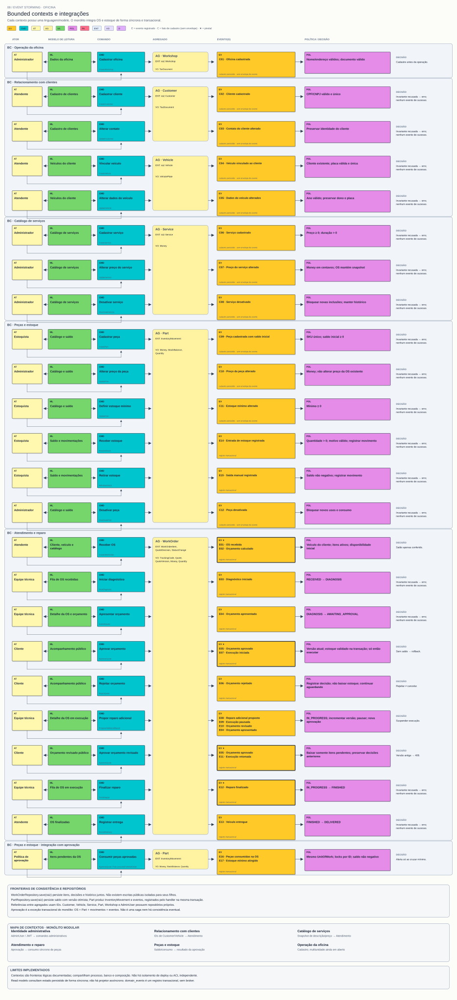

# 08 — Bounded contexts e integrações

**Objetivo:** Delimitar modelos e relações entre contextos.

[Visualizador](index.html) · [SVG](08-bounded-contexts.svg) · [Mermaid](08.mmd) · [Índice](../README.md)

- **Relacionamento com clientes:** identidade do cliente, vínculo e dados de veículo.
- **Catálogo de serviços:** serviço precificado; fornece snapshot à OS.
- **Peças e estoque:** catálogo de peças, saldo e movimentações.
- **Atendimento e reparo:** OS, orçamento, decisão, execução e entrega.
- **Identidade administrativa:** credenciais/JWT para operações administrativas.
- **Operação da oficina:** dados da oficina; multiunidade permanece aberta.

Atendimento consome IDs de cliente/veículo e snapshots de catálogo; aprovação chama Estoque dentro do mesmo UnitOfWork. Identidade protege os comandos administrativos; cliente usa o código público. Oficina não é um mega-agregado que contém todos os clientes e OS.

Essas são fronteiras lógicas no monólito. Os módulos ainda compartilham banco e composition; não são microsserviços nem possuem ACLs independentes. O bloco “integração” do quadro indica a interação entre contextos existentes, não um sétimo contexto.

**Saída:** mapa de contexto e contratos de integração, com limitações concretas visíveis.
